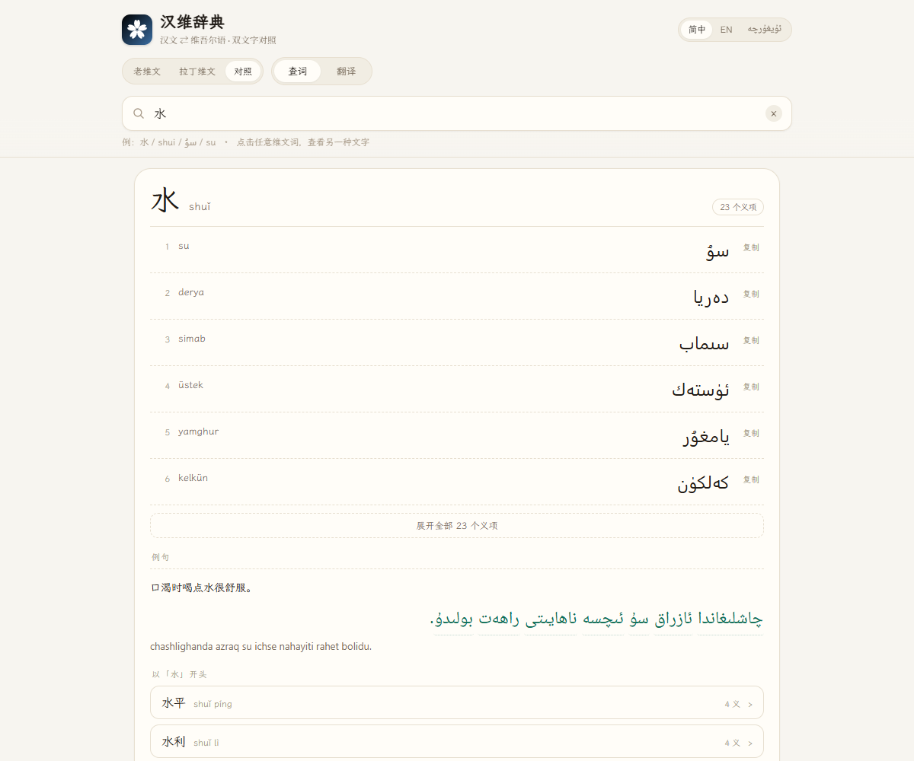
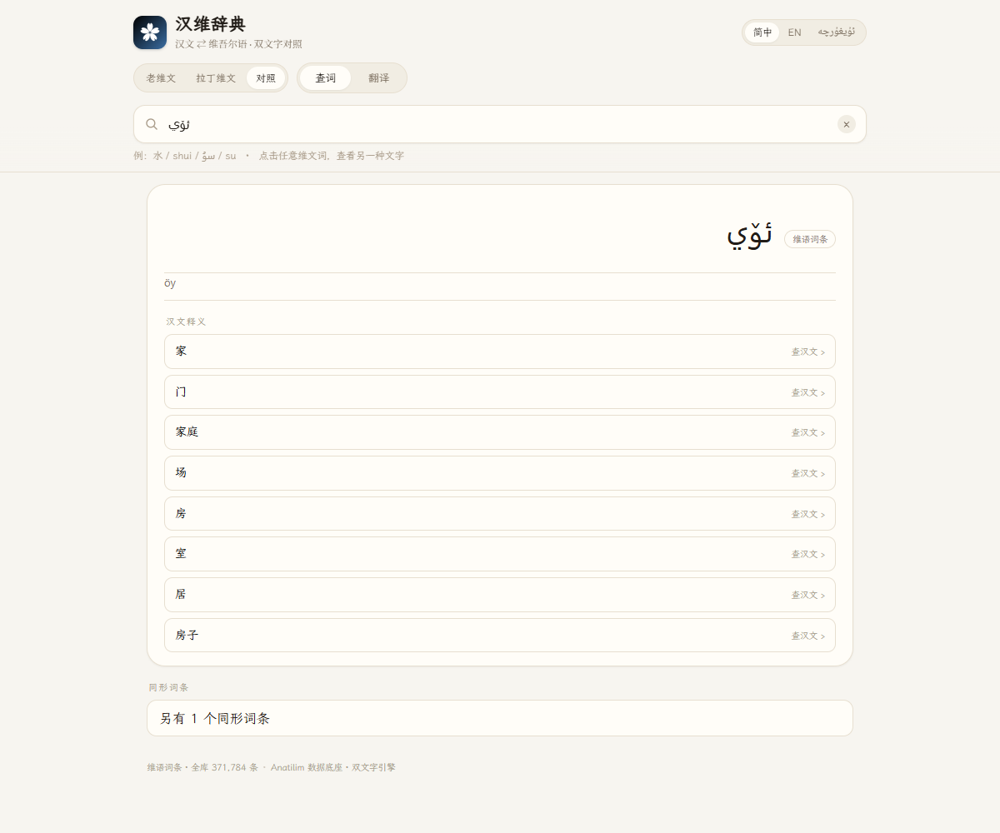
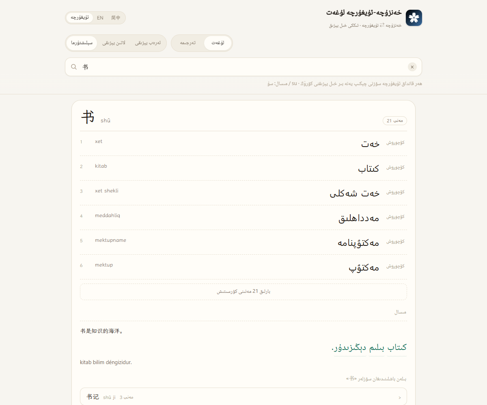

# Han–Uyghur Dictionary · 汉维辞典

<p align="center"></p>

[简体中文](README.md) · [English](README.en.md) · [ئۇيغۇرچە](README.ug.md)

A bidirectional **Hanwen ⇄ Uyghur** dictionary with both Uyghur scripts — Arabic (ئۇيغۇر ئەرەب يېزىقى) and Latin (لاتىن يېزىقى) — on the web, Windows and Android. Works offline.

**[▶ Open online](https://siqyin.github.io/hanuyghur-translate/)** · **[Download](https://github.com/SiqYin/hanuyghur-translate/releases/latest)**

<p align="center">
  
  
  
</p>

## What makes it different

Look up 水 and an ordinary dictionary gives you one Uyghur word and stops. Here you get the whole row, with both scripts always paired:

```
水  shuǐ                                    23 senses
1  su        سۇ        copy
2  derya     دەريا     copy
3  simab     سىماب     copy
```

- **The second script is computed, not copied.** Every Latin form is derived from the Arabic form by the 2009 orthography rules — hamza carriers, longest-match `ch/sh/gh/ng/zh`, `ك/ي` normalisation, ZWNJ handling. 93 round-trip cases pass.
- **Tap any Uyghur word to get the other script.** Arabic shows Latin, Latin shows Arabic, together with the dictionary entry it belongs to.
- **Inflected words go back to their lemma.** Tapping `ئىچىمەن` ("I drink") shows the lemma `ئىچمەك`, the suffixes `-ى` `-مەن`, and the Hanwen gloss 喝. Uyghur is agglutinative; without this, example sentences are unreadable.
- **Three UI languages, real RTL.** Simplified Chinese / ئۇيغۇرچە / English. In Uyghur the header, tabs and hints flip to right-to-left, while entry content keeps its own writing direction.

## Features

**Lookup**

- Hanwen → Uyghur: headword, pinyin, up to 23 senses, each copyable
- Uyghur → Hanwen: 371k Uyghur headwords with Hanwen glosses; tap a gloss to jump back
- Latin Uyghur and Hanwen pinyin both work: `su`, `shui`, `öy`, `oy` each land on the right entry
- Word family: frequent words starting with the current headword

**Dual script**

- Three display modes: Arabic / Latin / both
- Every Uyghur word in entries, examples and AI output is tappable
- Copy either side, or both at once

**Examples**

- Hanwen sentence + Uyghur sentence + Latin transliteration, three aligned lines
- Uyghur words are tappable one by one
- Examples and entries are sharded, so long-tail words never block first paint

**AI translation**

- Both directions, output in Arabic script with Latin derived automatically
- Output words are tappable
- Defaults to the public Index-Translate gateway; any OpenAI-compatible endpoint can be set under “Endpoint”. Settings stay on your device.

## Data scale

| Item | Count |
|---|---:|
| Hanwen headwords | <!--st:entries-->328,900<!--/st:entries--> |
| Hanwen senses | <!--st:senses-->532,192<!--/st:senses--> |
| Uyghur headwords | <!--st:ug-->371,784<!--/st:ug--> |
| Bilingual pairs | <!--st:pairs-->532,192<!--/st:pairs--> |
| Example sentences | <!--st:examples-->41,747<!--/st:examples--> |
| Core entries on first load | <!--st:core-->17,453<!--/st:core--> |

The Hanwen side of the examples reuses the Hannan dictionary corpus; the Uyghur side is AI-translated and still being extended and reviewed. Currently <!--st:examples-->41,747<!--/st:examples--> sentences, target 120,000.

## Download

| Platform | File | Notes |
|---|---|---|
| Web | [siqyin.github.io/hanuyghur-translate](https://siqyin.github.io/hanuyghur-translate/) | Nothing to install |
| Windows | [HanUyghurDict-1.0.0-win-x64.zip](https://github.com/SiqYin/hanuyghur-translate/releases/latest/download/HanUyghurDict-1.0.0-win-x64.zip) | Unzip and run, about 149 MB |
| Android | [HanUyghurDict-1.0.0-android.apk](https://github.com/SiqYin/hanuyghur-translate/releases/latest/download/HanUyghurDict-1.0.0-android.apk) | Sideload, Android 6.0+ |

These links always point at the latest release; older builds are under [Releases](https://github.com/SiqYin/hanuyghur-translate/releases).

## How it works

- **Single source of truth.** All Latin forms come from `app/ugconv.js` derived from Arabic script. UI, examples and AI output share one rule set, so the two scripts can never drift apart.
- **Morphology.** `app/morph.js` ships slot-grouped noun and verb suffix tables plus vowel-deletion restoration (`قەلەم → قەلىمى`) and candidate scoring: try the surface form, strip suffixes, then restore the vowel.
- **Direction.** Hanwen and Latin are LTR, Arabic script is RTL. Every Uyghur run is isolated with `dir` + `unicode-bidi:isolate` so punctuation never jumps to the wrong side.
- **Sharding.** 64 shards for Hanwen→Uyghur, 64 for Uyghur→Hanwen, 64 for examples, addressed by headword hash. First paint loads only the index and core entries.
- **Fully static.** No backend. Web, Windows and Android all run the same `app/` directory.

## Data sources and licensing

| Source | Use | Licence |
|---|---|---|
| [Anatilim Chinese–Uyghur dictionary](https://github.com/xhacker/chinese-uyghur) (`xhacker/chinese-uyghur`) | Main lexicon, both scripts aligned line by line | No explicit licence in the repository; treated as personal study/research use. See [NOTICE.md](NOTICE.md) |
| Hannan dictionary `examples.json` | Hanwen side of the examples (114,385 sentences) | Our own corpus; only the Hanwen side is reused |
| AI translation (Index-Translate / DeepSeek) | Uyghur side of examples, AI feature | Generated content, needs native review |

- Code is MIT licensed. **The dictionary data is not covered by MIT**; rights stay with the original providers.
- If a rights holder believes this repository exceeds their licence, please open an issue and we will remove the data or rebuild it under a proper licence.
- Before public deployment or commercial use, replace the data with clearly licensed corpora or obtain written permission.

## Local development

```bash
# Preview the web app (Node 18+)
node tools/serve.js 5200 app
# http://localhost:5200/?q=水

# Rebuild the lexicon (needs data/raw and data/clean, not shipped in the repo)
python tools/import_anatilim.py
python tools/build_app_data.py
python tools/build_ug_data.py
python tools/build_examples.py

# Windows desktop
cd desktop && npm install && npx electron-builder --win zip --x64

# Android (needs Android SDK and JDK 17)
cd mobile/android && gradle assembleDebug
```

## Roadmap

- [x] Dual-script engine (Arabic ⇄ Latin, 93 cases)
- [x] 328,900 Hanwen headwords / 532,192 senses
- [x] 371,784 Uyghur headwords (Uyghur→Hanwen)
- [x] Morphology (suffixes + vowel restoration)
- [x] Three UI languages (Chinese / Uyghur / English)
- [x] Three platforms (Web / Windows / Android)
- [ ] 120,000 examples with native review
- [ ] Top-2 morphology candidates
- [ ] Deeper full-site RTL adaptation

## Credits

- Lexicon: [Anatilim](https://github.com/xhacker/chinese-uyghur)
- Fonts: [LXGW WenKai](https://github.com/lxgw/LxgwWenKai), [Noto Naskh Arabic](https://fonts.google.com/noto/specimen/Noto+Naskh+Arabic) (both SIL OFL 1.1)
- Translation models: [Index-Translate](https://github.com/bilibili/Index-Translate), [DeepSeek](https://www.deepseek.com/)
- Sister project: [Hannan Dictionary](https://github.com/SiqYin/zhongviet-translate)
