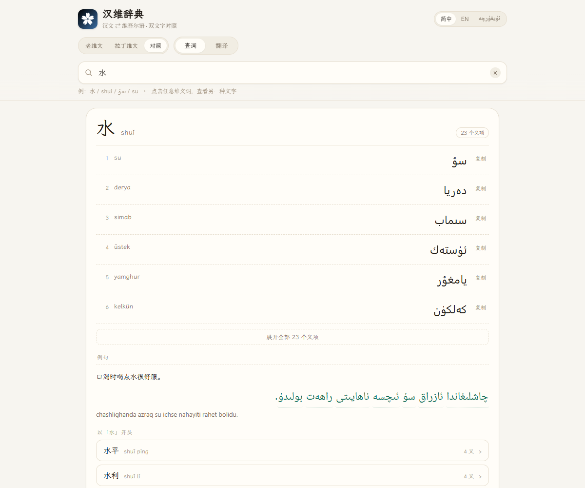
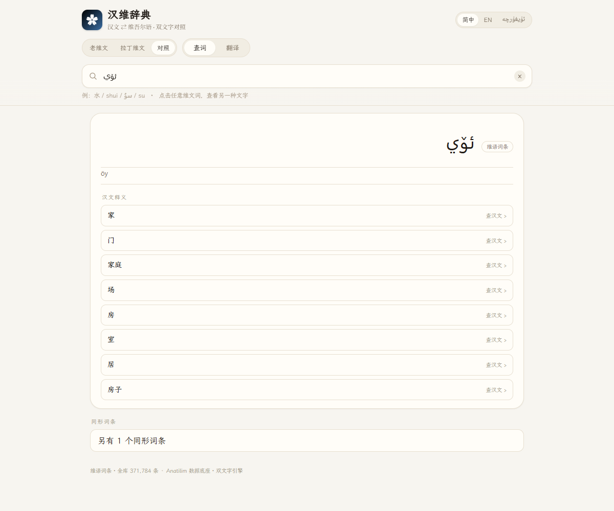
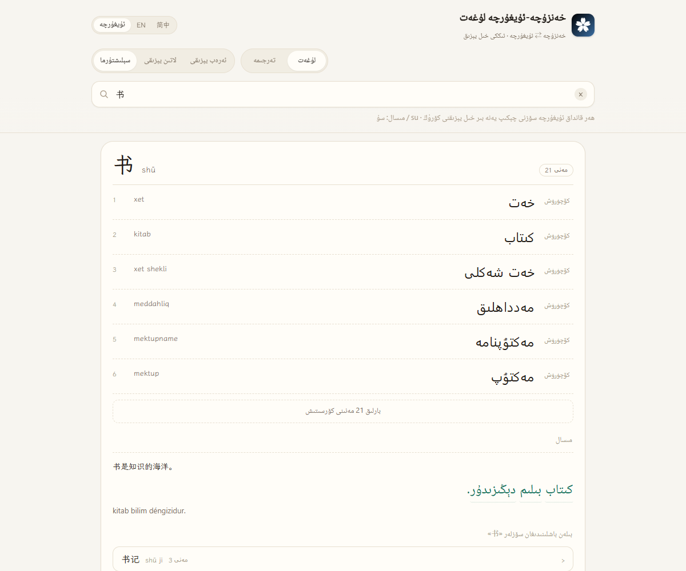

# 汉维辞典 · Han–Uyghur Dictionary

<p align="center"></p>

[简体中文](README.md) · [English](README.en.md) · [ئۇيغۇرچە](README.ug.md)

汉文 ⇄ 维吾尔语双向词典 · 老维文（ئۇيغۇر ئەرەب يېزىقى）与拉丁维文（لاتىن يېزىقى）双文字 · 网页 / Windows / Android 三端 · 离线可用

**[▶ 在线使用](https://siqyin.github.io/hanuyghur-translate/)** · **[下载三端](https://github.com/SiqYin/hanuyghur-translate/releases/latest)**

<p align="center">
  
  
  
</p>

## 它和一般汉维词典不一样的地方

查「水」，一般词典给你一个维文词就结束了。这里给你的是完整的一行，而且两种文字始终成对：

```
水  shuǐ                                    23 个义项
1  su        سۇ        复制
2  derya     دەريا     复制
3  simab     سىماب     复制
```

- **双文字不是查表，是规则转换。** 全库拉丁维文由老维文按 2009 标准正字法派生，`hamza` 载体、`ch/sh/gh/ng/zh` 最长匹配、`ك/ي` 归一化、ZWNJ 处理都写进了引擎，93 条回环用例通过。
- **点一个维文词，就得到另一种文字。** 老维文点开是拉丁维文，拉丁点开是老维文，同时给出词典对应词条。
- **屈折词能回到原形。** 点 `ئىچىمەن`（我喝）显示原形 `ئىچمەك`、词尾 `-ى` `-مەن`，以及汉文释义「喝」。维吾尔语是粘着语，这一步决定了例句能不能读。
- **界面三语，维语界面真 RTL。** 简体中文 / ئۇيغۇرچە / English；维语模式下顶栏、标签、提示全部右起，词条内容仍按各自书写方向渲染。

## 功能

**查词**

- 汉文 → 维语：词头、拼音、最多 23 个义项，逐条可复制
- 维语 → 汉文：37 万条维语词头，给汉文释义，点释义回跳汉文词条
- 拉丁维文与汉文拼音都能直接输入：`su`、`shui`、`öy`、`oy` 分别落到正确词条
- 词族：以当前词开头的高频词，一键展开

**双文字**

- 三种显示模式：老维文 / 拉丁维文 / 对照
- 词条、例句、AI 译文中的每个维文词都可点，弹出另一侧文字
- 复制任一侧，或两侧一起复制

**例句**

- 汉文例句 + 老维文译文 + 拉丁维文，三行对照
- 维文逐词可点，读完一句可以逐个词查
- 例句与词条分片加载，长尾词不会拖慢首屏

**AI 翻译**

- 汉-维 / 维-汉 双向，输出老维文并自动派生拉丁维文
- 译文逐词可点
- 默认接公共 Index-Translate 网关；可在「接口设置」里换成任意 OpenAI 兼容端点，配置只保存在本机

## 数据规模

| 项目 | 数量 |
|---|---:|
| 汉文词头 | <!--st:entries-->328,900<!--/st:entries--> |
| 汉文义项 | <!--st:senses-->532,192<!--/st:senses--> |
| 维语词头（维-汉） | <!--st:ug-->371,784<!--/st:ug--> |
| 汉维双语词对 | <!--st:pairs-->532,192<!--/st:pairs--> |
| 例句 | <!--st:examples-->41,747<!--/st:examples--> |
| 首屏核心词条 | <!--st:core-->17,453<!--/st:core--> |

例句的汉文侧复用汉南辞典语料，维文侧为 AI 翻译，正在持续扩充与审校；当前 <!--st:examples-->41,747<!--/st:examples--> 条，目标 120,000 条。

## 下载

| 平台 | 文件 | 说明 |
|---|---|---|
| 网页 | [siqyin.github.io/hanuyghur-translate](https://siqyin.github.io/hanuyghur-translate/) | 免安装 |
| Windows | [HanUyghurDict-1.0.0-win-x64.zip](https://github.com/SiqYin/hanuyghur-translate/releases/latest/download/HanUyghurDict-1.0.0-win-x64.zip) | 解压即用，约 149 MB |
| Android | [HanUyghurDict-1.0.0-android.apk](https://github.com/SiqYin/hanuyghur-translate/releases/latest/download/HanUyghurDict-1.0.0-android.apk) | 直接安装，Android 6.0+ |

链接固定指向最新版本；旧版见 [Releases](https://github.com/SiqYin/hanuyghur-translate/releases)。

## 技术说明

- **单一真源**：所有拉丁维文由 `app/ugconv.js` 从老维文派生，界面、例句、AI 译文共用同一套规则，不存在两套数据不同步的问题。
- **词形还原**：`app/morph.js` 内置按槽位分组的名词/动词后缀表，配合元音弱化（`قەلەم → قەلىمى`）与候选打分；先试原形，再剥后缀，再还原弱化。
- **方向处理**：汉文与拉丁维文 LTR，老维文 RTL；每个维文片段用 `dir` + `unicode-bidi:isolate` 隔离，避免标点被拉到错误一侧。
- **分片加载**：汉-维 64 片、维-汉 64 片、例句 64 片，按词头哈希定位，首屏只加载索引与核心词条。
- **纯静态**：没有后端。网页、Windows、Android 共用同一套 `app/` 目录。

## 数据来源与授权

| 来源 | 用途 | 授权 |
|---|---|---|
| [Anatilim 汉维双向词典](https://github.com/xhacker/chinese-uyghur)（`xhacker/chinese-uyghur`） | 词库主体，双文字逐行对齐 | 仓库未附明确许可证，按“个人学习/研究”定位使用，详见 [NOTICE.md](NOTICE.md) |
| 汉南辞典 `examples.json` | 例句的汉文侧（114,385 条） | 本项目自有语料，仅复用汉文侧 |
| AI 翻译（Index-Translate 公共网关） | 例句维文、AI 翻译功能 | 生成内容，需母语审校 |

- 代码以 MIT 发布；**词典数据不适用 MIT**，权利归原始数据提供方。
- 若权利人认为本仓库的使用超出许可，请开 issue，我们会移除相关数据或按授权重建。
- 公开部署或商用前，建议替换为明确授权的语料，或取得书面许可。

## 本地开发

```bash
# 预览网页版（Node 18+）
node tools/serve.js 5200 app
# http://localhost:5200/?q=水

# 重建词库（需要 data/raw 与 data/clean，体积大，不随仓库分发）
python tools/import_anatilim.py
python tools/build_app_data.py
python tools/build_ug_data.py
python tools/build_examples.py

# Windows 桌面版
cd desktop && npm install && npx electron-builder --win zip --x64

# Android（需要 Android SDK 与 JDK 17）
cd mobile/android && gradle assembleDebug
```

## 路线图

- [x] 双文字引擎（老维文 ⇄ 拉丁维文，93 条用例）
- [x] 32.9 万汉文词头 / 53.2 万义项
- [x] 37.2 万维语词头（维-汉）
- [x] 词形还原（后缀 + 元音弱化）
- [x] 三语界面（简中 / 维语 / 英文）
- [x] 三端打包（Web / Windows / Android）
- [ ] 例句 12 万条 + 母语审校抽样
- [ ] 词形还原 top-2 候选展示
- [ ] 维吾尔语全站 RTL 深度适配

## 致谢

- 词库：[Anatilim](https://github.com/xhacker/chinese-uyghur)
- 字体：[霞鹜文楷 LXGW WenKai](https://github.com/lxgw/LxgwWenKai)、[Noto Naskh Arabic](https://fonts.google.com/noto/specimen/Noto+Naskh+Arabic)（均为 SIL OFL 1.1）
- 翻译模型：[Index-Translate](https://github.com/bilibili/Index-Translate)（免费公共网关）
- 姊妹项目：[汉南辞典](https://github.com/SiqYin/zhongviet-translate)
