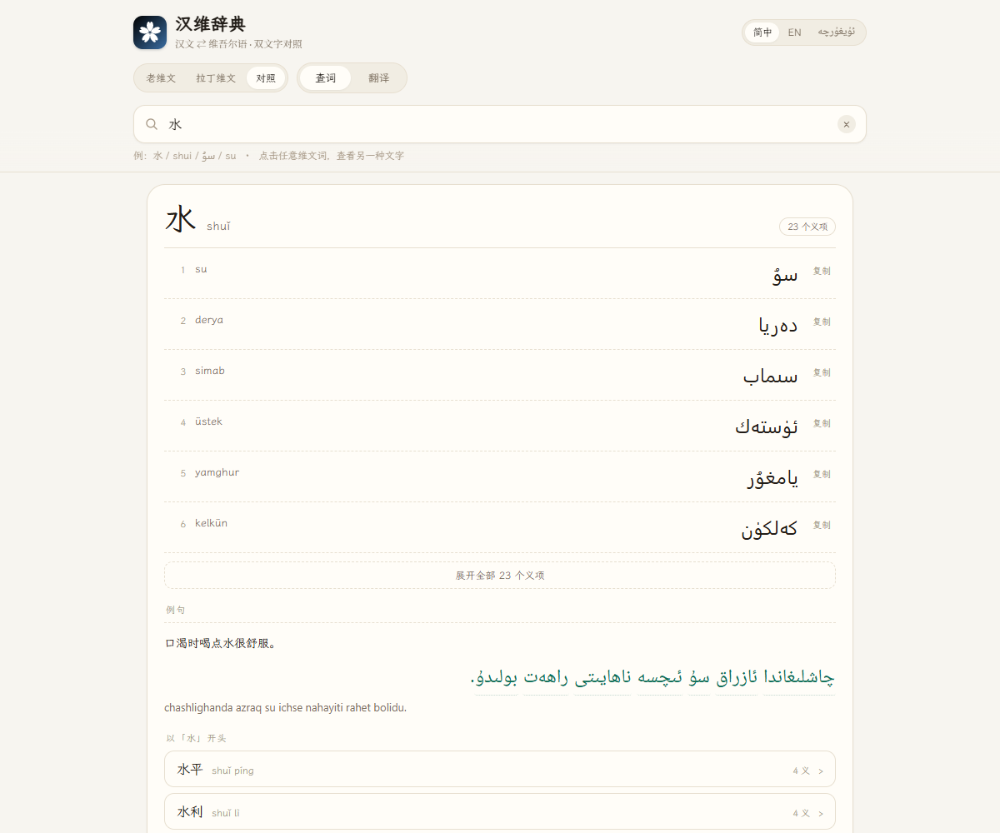
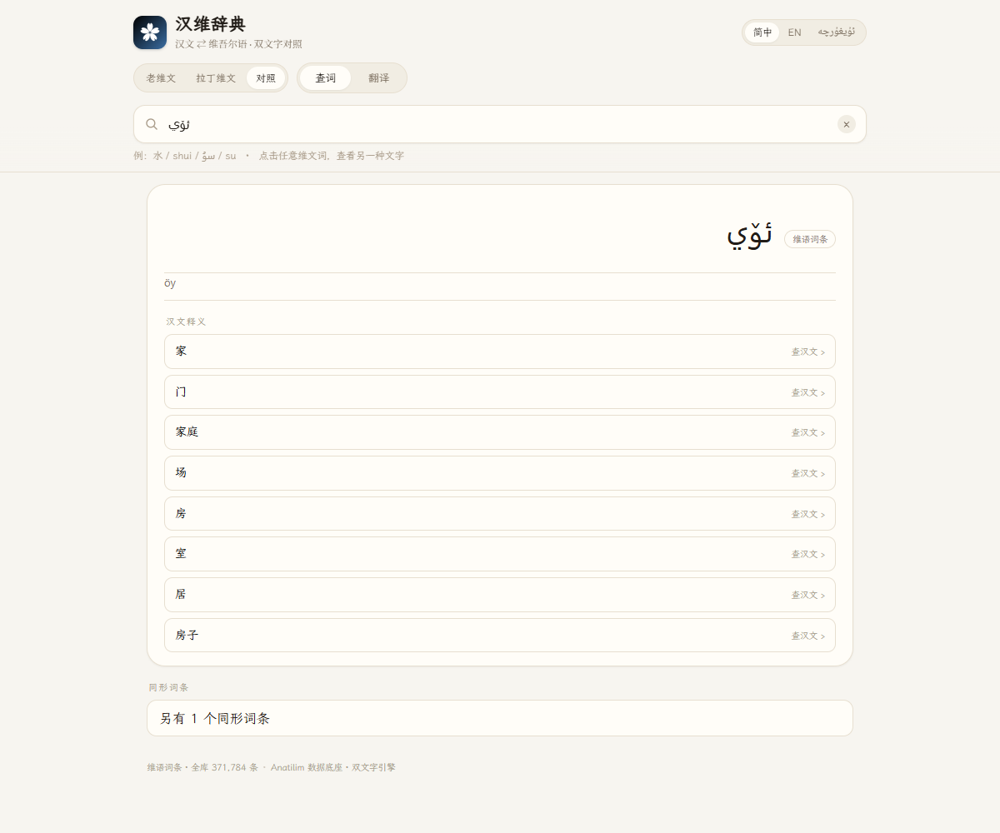
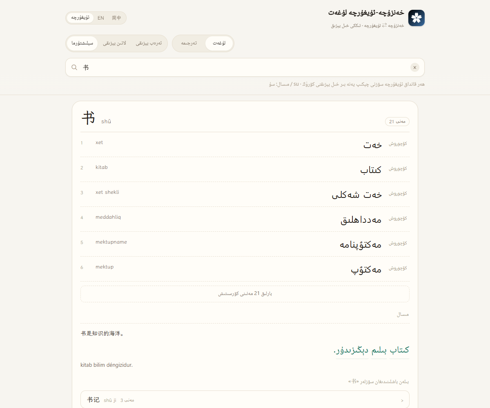

# خەنزۇچە-ئۇيغۇرچە لۇغەت · 汉维辞典

<p align="center"></p>

[简体中文](README.md) · [English](README.en.md) · [ئۇيغۇرچە](README.ug.md)

خەنزۇچە ⇄ ئۇيغۇرچە ئىككى تەرەپلىمە لۇغەت · ئۇيغۇر ئەرەب يېزىقى ۋە لاتىن يېزىقى ئىككى خىل يېزىق · تور بەت / Windows / Android ئۈچ ئۇچى · تورسىزمۇ ئىشلەيدۇ

**[▶ توردا ئىشلىتىش](https://siqyin.github.io/hanuyghur-translate/)** · **[ئۈچ ئۇچنى چۈشۈرۈش](https://github.com/SiqYin/hanuyghur-translate/releases/latest)**

<p align="center">
  
  
  
</p>

## ئادەتتىكى لۇغەتلەردىن پەرقى

«水» نى ئىزدىسىڭىز، ئادەتتىكى لۇغەت سىزگە بىر ئۇيغۇرچە سۆز بېرىپ توختايدۇ. بۇ يەردە بولسا پۈتۈن قۇر بېرىلىدۇ، ئىككى خىل يېزىق ھەمىشە جۈپ ھالەتتە:

```
水  shuǐ                                    23 مەنى
1  su        سۇ        كۆچۈرۈش
2  derya     دەريا     كۆچۈرۈش
3  simab     سىماب     كۆچۈرۈش
```

- **ئىككىنچى يېزىق جەدۋەلدىن ئەمەس، قائىدىدىن ھاسىل بولىدۇ.** بارلىق لاتىن يېزىقى ئەرەب يېزىقىدىن 2009-يىللىق ئىملا قائىدىسى بويىچە ھاسىل قىلىنىدۇ: ھەمزە تايانچىسى، `ch/sh/gh/ng/zh` ئۇزۇن ئۇيغۇنلاشتۇرۇش، `ك/ي` نورماللاشتۇرۇش، ZWNJ بىر تەرەپ قىلىش ماتورغا كىرگۈزۈلگەن؛ 93 سىناق ئوبوروتتىن ئۆتتى.
- **ھەر قانداق ئۇيغۇرچە سۆزنى چەكسىڭىز، يەنە بىر يېزىقى چىقىدۇ.** ئەرەب يېزىقىنى چەكسىڭىز لاتىن، لاتىننى چەكسىڭىز ئەرەب يېزىقى، ھەمدە ماس لۇغەت تېمىسى بىللە كۆرسىتىلىدۇ.
- **تۈرلەنگەن شەكىللەر ئاساس شەكىلگە قايتىدۇ.** `ئىچىمەن` نى چەكسىڭىز ئاساس شەكىل `ئىچمەك`، ئارقا قوشۇمچە `-ى` `-مەن` ۋە خەنزۇچە ئىزاھاتى «喝» كۆرۈنىدۇ. ئۇيغۇر تىلى يېپىشقاق تىل، بۇ قەدەم مىسال جۈملىنى ئوقۇيالىشىڭىزنى بەلگىلەيدۇ.
- **ئۈچ تىللىق كۆرۈنۈش، ئۇيغۇرچە كۆرۈنۈشتە ھەقىقىي RTL.** 简体中文 / ئۇيغۇرچە / English؛ ئۇيغۇرچە ھالەتتە ئۈستى قۇر، بەتكۈچ ۋە ئەسكەرتىشلەر ئوڭدىن سولغا، تېما مەزمۇنى بولسا ئۆز يېزىق يۆنىلىشى بويىچە.

## ئىقتىدارلىرى

**ئىزدەش**

- خەنزۇچە → ئۇيغۇرچە: باش سۆز، پىنيىن، 23 مەنىگىچە، ھەر بىرىنى كۆچۈرگىلى بولىدۇ
- ئۇيغۇرچە → خەنزۇچە: 37 مىڭ ئۇيغۇرچە باش سۆز، خەنزۇچە ئىزاھات بىلەن؛ ئىزاھاتنى چەكسىڭىز خەنزۇچە تېمىغا قايتىسىز
- لاتىن يېزىقى ۋە پىنيىن ئىككىسىنى كىرگۈزگىلى بولىدۇ: `su`، `shui`، `öy`، `oy` ھەر بىرى توغرا تېمىغا چۈشىدۇ
- سۆز ئائىلىسى: نۆۋەتتىكى سۆز بىلەن باشلىنىدىغان يۇقىرى چاستوتىلىق سۆزلەر

**ئىككى خىل يېزىق**

- ئۈچ كۆرسىتىش ھالىتى: ئەرەب يېزىقى / لاتىن يېزىقى / سېلىشتۇرما
- تېما، مىسال ۋە AI تەرجىمىسىدىكى ھەر بىر ئۇيغۇرچە سۆزنى چەككىلى بولىدۇ
- بىر تەرىپىنى ياكى ئىككىسىنى بىرلا ۋاقىتتا كۆچۈرگىلى بولىدۇ

**مىساللار**

- خەنزۇچە جۈملە + ئۇيغۇرچە جۈملە + لاتىن يېزىقى، ئۈچ قۇر سېلىشتۇرما
- ئۇيغۇرچە سۆزلەرنى بىر-بىرلەپ چەككىلى بولىدۇ
- مىسال ۋە تېمىلار بۆلەكلەرگە ئايرىلغان، ئۇزۇن قۇيرۇق سۆزلەر بىرىنچى ئېكراننى ئاستىلاتمايدۇ

**AI تەرجىمە**

- ئىككى يۆنىلىش: خەنزۇچە-ئۇيغۇرچە / ئۇيغۇرچە-خەنزۇچە، نەتىجە ئەرەب يېزىقىدا، لاتىن يېزىقى ئاپتوماتىك ھاسىل بولىدۇ
- تەرجىمە سۆزلىرىنى چەككىلى بولىدۇ
- سۈكۈتتە ئاممىۋى Index-Translate مۇلازىمېتىرى ئىشلىتىلىدۇ؛ «ئىنتېرفېيس تەڭشىكى» دىن خالىغان OpenAI ماس كېلىدىغان ئۇلىنىشقا ئالماشتۇرغىلى بولىدۇ، تەڭشەك پەقەت بۇ ئۈسكۈنىدە ساقلىنىدۇ

## سانلىق ئۆلچەم

| تۈر | سان |
|---|---:|
| خەنزۇچە باش سۆز | <!--st:entries-->328,900<!--/st:entries--> |
| خەنزۇچە مەنى | <!--st:senses-->532,192<!--/st:senses--> |
| ئۇيغۇرچە باش سۆز | <!--st:ug-->371,784<!--/st:ug--> |
| ئىككى تىللىق جۈپ | <!--st:pairs-->532,192<!--/st:pairs--> |
| مىسال جۈملە | <!--st:examples-->41,747<!--/st:examples--> |
| بىرىنچى ئېكران تېمىسى | <!--st:core-->17,453<!--/st:core--> |

مىساللارنىڭ خەنزۇچە تەرىپى خەننەن لۇغىتىدىن ئېلىنغان، ئۇيغۇرچە تەرىپى AI تەرجىمىسى بولۇپ، داۋاملىق كېڭەيتىلىۋاتىدۇ ۋە تەكشۈرۈلۈۋاتىدۇ؛ ھازىر <!--st:examples-->41,747<!--/st:examples--> جۈملە، نىشان 120,000.

## چۈشۈرۈش

| ئۇچ | ھۆججەت | چۈشەندۈرۈش |
|---|---|---|
| تور بەت | [siqyin.github.io/hanuyghur-translate](https://siqyin.github.io/hanuyghur-translate/) | قاچىلاش زۆرۈر ئەمەس |
| Windows | [HanUyghurDict-1.0.0-win-x64.zip](https://github.com/SiqYin/hanuyghur-translate/releases/latest/download/HanUyghurDict-1.0.0-win-x64.zip) | يېشىپ ئىشلىتىڭ، تەخمىنەن 149 MB |
| Android | [HanUyghurDict-1.0.0-android.apk](https://github.com/SiqYin/hanuyghur-translate/releases/latest/download/HanUyghurDict-1.0.0-android.apk) | بىۋاسىتە قاچىلاڭ، Android 6.0+ |

بۇ ئۇلىنىشلار ھەمىشە ئەڭ يېڭى نەشرىگە كۆرسىتىدۇ؛ كونا نەشرىلەر [Releases](https://github.com/SiqYin/hanuyghur-translate/releases) بېتىدە.

## تېخنىكىلىق چۈشەندۈرۈش

- **بىرلا مەنبە.** بارلىق لاتىن يېزىقى `app/ugconv.js` ئارقىلىق ئەرەب يېزىقىدىن ھاسىل قىلىنىدۇ. كۆرۈنۈش، مىسال ۋە AI تەرجىمىسى ئوخشاش قائىدىنى ئىشلىتىدۇ، ئىككى يېزىق ئايرىلىپ قېلىشى مۇمكىن ئەمەس.
- **شەكىل ئەسلىگە قايتۇرۇش.** `app/morph.js` ئىچىدە ئورۇن بويىچە گۇرۇپپىلانغان ئىسىم/پېئىل قوشۇمچە جەدۋىلى، ئۇنىڭغا سوزۇق تاۋۇش ئاجىزلىشىشىنى ئەسلىگە قايتۇرۇش (`قەلەم → قەلىمى`) ۋە نامزات باھالاش قوشۇلغان.
- **يۆنىلىش.** خەنزۇچە ۋە لاتىن LTR، ئەرەب يېزىقى RTL؛ ھەر بىر ئۇيغۇرچە بۆلەك `dir` + `unicode-bidi:isolate` بىلەن ئايرىلىدۇ، تىنىش بەلگىلىرى خاتا تەرەپكە ئۆتمەيدۇ.
- **بۆلەك يۈكلەش.** خەنزۇچە→ئۇيغۇرچە 64 بۆلەك، ئۇيغۇرچە→خەنزۇچە 64 بۆلەك، مىسال 64 بۆلەك، باش سۆز خېشى بويىچە ئورۇنلاشتۇرۇلغان. بىرىنچى ئېكران پەقەت ئىندېكس ۋە ئاساسىي تېمىلارنى يۈكلەيدۇ.
- **پۈتۈنلەي ستاتىك.** ئارقا مۇلازىمېتىر يوق. تور بەت، Windows ۋە Android ئوخشاش `app/` مۇندەرىجىسىنى ئىشلىتىدۇ.

## سانلىق مەنبەسى ۋە ئىجازەت

| مەنبە | ئىشلىتىلىشى | ئىجازەت |
|---|---|---|
| [Anatilim خەنزۇچە-ئۇيغۇرچە لۇغەت](https://github.com/xhacker/chinese-uyghur) | لۇغەت ئاساسى، ئىككى يېزىق قۇربىقۇر ماسلاشتۇرۇلغان | ئامباردا ئېنىق ئىجازەت يوق، شەخسىي ئۆگىنىش/تەكشۈرۈش ئۈچۈن، [NOTICE.md](NOTICE.md) نى كۆرۈڭ |
| خەننەن لۇغىتى `examples.json` | مىساللارنىڭ خەنزۇچە تەرىپى (114,385 جۈملە) | ئۆز كورپۇسىمىز، پەقەت خەنزۇچە تەرىپى ئىشلىتىلدى |
| AI تەرجىمە (Index-Translate ئاممىۋى مۇلازىمېتىرى) | مىساللارنىڭ ئۇيغۇرچە تەرىپى، AI ئىقتىدارى | ھاسىل قىلىنغان مەزمۇن، ئانا تىل تەكشۈرۈشى زۆرۈر |

- كود MIT ئىجازىتى بىلەن تارقىتىلىدۇ؛ **لۇغەت سانلىقى MIT گە كىرمەيدۇ**، ھوقۇق ئەسلى تەمىنلىگۈچىگە تەۋە.
- ئەگەر ھوقۇق ئىگىسى بۇ ئامبارنىڭ ئىشلىتىلىشى ئىجازەتتىن ئېشىپ كەتتى دەپ قارىسا، issue ئېچىڭ، بىز مۇناسىۋەتلىك سانلىقنى ئۆچۈرىمىز ياكى ئىجازەت بويىچە قايتا قۇرىمىز.
- ئاشكارا ئورۇنلاشتۇرۇش ياكى سودا ئىشلىتىشتىن بۇرۇن، ئېنىق ئىجازەتلىك كورپۇسقا ئالماشتۇرۇش ياكى يازما ئىجازەت ئېلىش تەۋسىيە قىلىنىدۇ.

## يەرلىك ئېچىش

```bash
# تور بەتنى كۆرۈش (Node 18+)
node tools/serve.js 5200 app
# http://localhost:5200/?q=水

# لۇغەتنى قايتا قۇرۇش (data/raw ۋە data/clean زۆرۈر، ئامبارغا كىرگۈزۈلمەيدۇ)
python tools/import_anatilim.py
python tools/build_app_data.py
python tools/build_ug_data.py
python tools/build_examples.py

# Windows ئۈستەل نەشرىسى
cd desktop && npm install && npx electron-builder --win zip --x64

# Android (Android SDK ۋە JDK 17 زۆرۈر)
cd mobile/android && gradle assembleDebug
```

## يول خەرىتىسى

- [x] ئىككى يېزىق ماتورى (ئەرەب ⇄ لاتىن، 93 سىناق)
- [x] 328,900 خەنزۇچە باش سۆز / 532,192 مەنى
- [x] 371,784 ئۇيغۇرچە باش سۆز (ئۇيغۇرچە→خەنزۇچە)
- [x] شەكىل ئەسلىگە قايتۇرۇش (قوشۇمچە + سوزۇق تاۋۇش)
- [x] ئۈچ تىللىق كۆرۈنۈش (خەنزۇچە / ئۇيغۇرچە / ئىنگلىزچە)
- [x] ئۈچ ئۇچ قاچىلاش (Web / Windows / Android)
- [ ] 120,000 مىسال + ئانا تىل تەكشۈرۈش
- [ ] شەكىل ئەسلىگە قايتۇرۇشتا ئىككىنچى نامزاتنى كۆرسىتىش
- [ ] ئۇيغۇرچە پۈتۈن بەت RTL چوڭقۇر ماسلاشتۇرۇش

## رەھمەت-تەشەككۈر

- لۇغەت: [Anatilim](https://github.com/xhacker/chinese-uyghur)
- خەت نۇسخىسى: [LXGW WenKai](https://github.com/lxgw/LxgwWenKai)، [Noto Naskh Arabic](https://fonts.google.com/noto/specimen/Noto+Naskh+Arabic) (SIL OFL 1.1)
- تەرجىمە مودېلى: [Index-Translate](https://github.com/bilibili/Index-Translate) (ھەقسىز ئاممىۋى مۇلازىمەت)
- قېرىنداش تۈر: [خەننەن لۇغىتى](https://github.com/SiqYin/zhongviet-translate)
